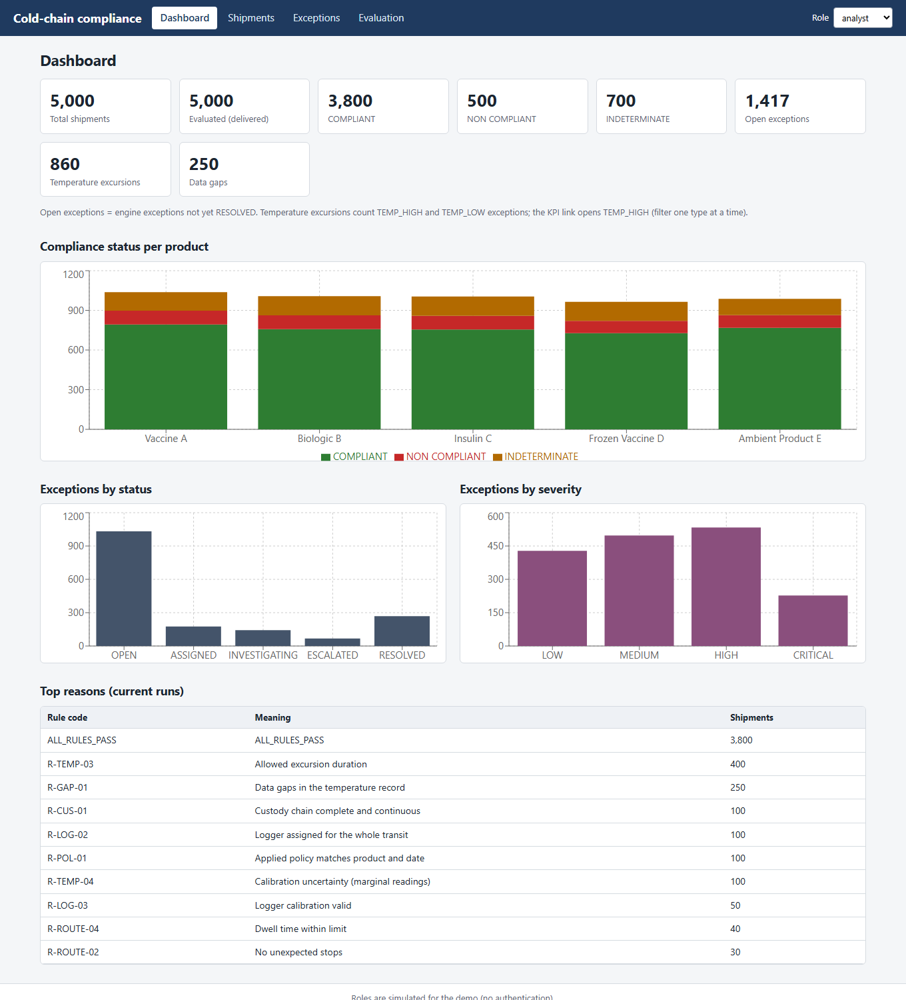
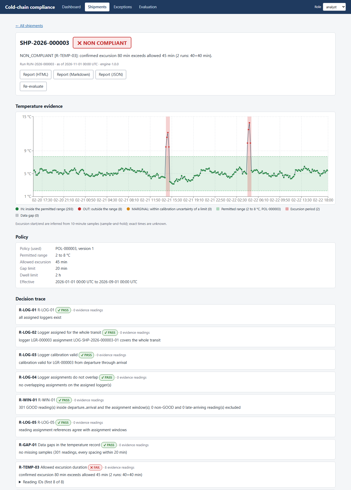
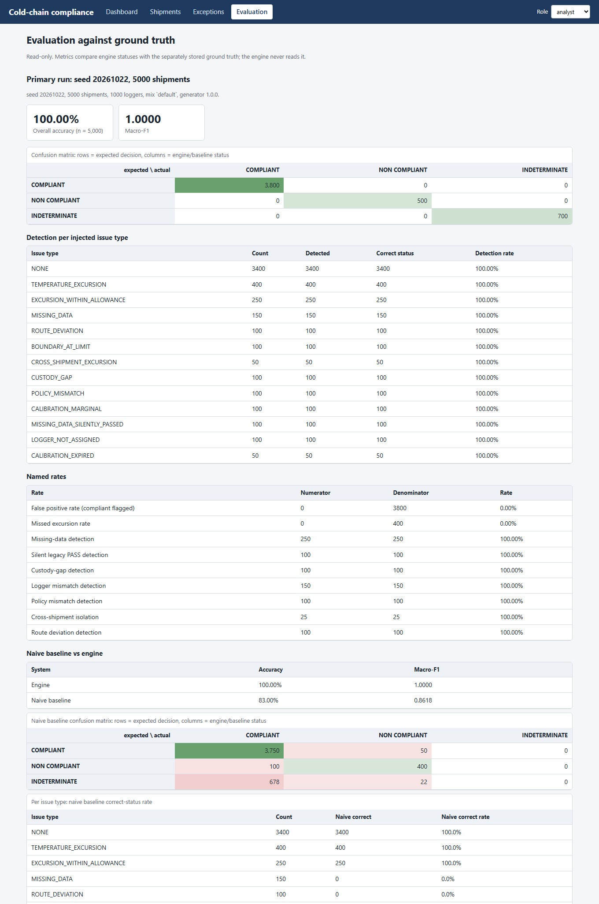

# coldchain-compliance

**Business question:** *Prove that temperature-sensitive shipments remained within product and route requirements, and manage deviations.*

This repository is a deterministic prototype that answers it end to end on synthetic data:

1. a **seeded generator** produces 5,000 shipments, 1,000 loggers and about 1.2 million temperature readings, with 13 labelled anomaly types injected on purpose and the expected answer stored separately as **ground truth**;
2. a **rule-based compliance engine** decides COMPLIANT, NON_COMPLIANT or INDETERMINATE per shipment and cites the rule and the exact readings behind every finding (no AI in the decision path);
3. **traceable reports** (Markdown, HTML, JSON) and an **exception workflow** (OPEN to RESOLVED) manage the deviations the engine finds;
4. an **evaluation** compares the engine with the ground truth, a naive baseline and an ablation;
5. a **SQLite database**, a **REST API** and a **React UI** make it usable.

What it proves, and what it does not: the engine does exactly what the documented rules say, reproducibly, with evidence. It does not prove accuracy on real cold-chain data (see [Honest limitations](#honest-limitations)).

## Screenshots
Captured from the running app on the 5,000-shipment dataset.



*Dashboard: 3,800 compliant, 500 non-compliant and 700 indeterminate shipments, 1,417 open exceptions, and the top rule codes behind the decisions.*



*Shipment detail: the permitted temperature band, the shaded excursion periods and the decision trace that explains the status rule by rule.*



*Evaluation: confusion matrix and per-issue detection against ground truth, with the naive baseline comparison below.*

## Requirements
- Node.js **>= 22.13** (`node:sqlite`). Tested on **v24.18.1** (Windows 10). No other tools; no database server.
- npm. Runtime dependency of the server: `express`. The UI in `client/` has its own dependencies (React, React Router, Recharts, Vite, Vitest).

## Quick start
Copy-paste, from an empty folder. This builds the 100-shipment sample and serves the UI (about 2 minutes).

```bash
git clone https://github.com/mohit-k1708/coldchain-compliance.git
cd coldchain-compliance
npm install
npm run client:install
npm run generate -- --seed=20261022 --shipments=100
npm run evaluate
npm run db:build
npm run client:build
npm start
```

Then open:
- UI: http://localhost:3001
- API health: http://localhost:3001/api/health
- Dashboard data: http://localhost:3001/api/dashboard

For hot reload while developing the UI, keep `npm start` running and run `npm run client:dev` in a second terminal (UI at http://localhost:5173, proxies `/api` to port 3001).

### Environment variables
| variable | default | meaning |
|---|---|---|
| `PORT` | `3001` | HTTP port of the server (`server/index.js`) |
| `DB_PATH` | `data/app.db` | SQLite file the server opens (`npm start`); the build script writes `data/app.db` unless `--db=` is given |

## Data generation
Seed **20261022**, one fixed set of volumes. The sizes below use the default logger count unless stated.

| shipments | command | notes |
|---|---|---|
| 10 | `npm run generate -- --seed=20261022 --shipments=10` | smoke test |
| 100 | `npm run generate -- --seed=20261022 --shipments=100` | the committed sample in `data/sample` |
| 1,000 | `npm run generate -- --seed=20261022 --shipments=1000` | |
| 5,000 | `npm run generate -- --seed=20261022 --shipments=5000 --loggers=1000` | the full dataset: 1,196,041 readings (141.8 MB of CSV) |

Output goes to `data/generated` (git-ignored; override with `--out=`): 22 table CSVs, `ground_truth.csv` and `manifest.json` (row counts and sha256 per file). Useful follow-ups:

```bash
npm run validate                 # integrity + business-observation checks on data/generated
npm run evaluate                 # engine -> data/results
npm run metrics                  # engine vs ground truth (+ holdout seed 777), writes docs/EVALUATION-REPORT.*
npm run stats                    # docs/DISTRIBUTIONS.md
npm run report -- --shipment=SHP-2026-000001   # traceable report to stdout
```

The full dataset is committed gzip-compressed in `data/full` (23 `.csv.gz` files, about 14 MB, every file under 50 MB, `MANIFEST.json` holds the checksums of the uncompressed files). `npm run export:full` rebuilds it. `npm run export:sql` / `npm run export:json` write SQL and JSON exports.

## Reproducibility
`npm run reproduce` runs the generator twice in separate processes and compares row counts and sha256 of every file, ground truth included. Latest result at 5,000 shipments and 1,000 loggers: **PASS** (details in [docs/REPRODUCIBILITY.md](docs/REPRODUCIBILITY.md)). Use `npm run reproduce -- --shipments=5000 --loggers=1000` to repeat that exact run.

## Testing
| command | what it runs |
|---|---|
| `npm test` | all root tests with `node --test`: schema, generator, anomalies, engine (unit, integration, gating, reports, exceptions), evaluation, property tests, scale, API, static UI, docs |
| `npm --prefix client test` | the UI's pure-function tests (Vitest) |
| `npm run verify` | `npm test` + validation of the committed sample + reproducibility at 100 shipments, in under 2 minutes, writes no docs |

The property test (`tests/property/excursion.property.test.js`) compares the excursion arithmetic with an independent oracle on 2,000 seeded random cases.

## Architecture
A modular monolith: generator -> CSV -> engine -> results -> SQLite -> REST API -> React UI. Module responsibilities, data flow, key decisions with alternatives, the five failure categories, security and scalability notes: [docs/ARCHITECTURE.md](docs/ARCHITECTURE.md).

## Database
22 tables, portable DDL, effective-dated policies and calibrations, append-only history: [docs/DATABASE-SCHEMA.md](docs/DATABASE-SCHEMA.md) (ER diagram, keys, cardinality, indexes), [docs/DATA-DICTIONARY.md](docs/DATA-DICTIONARY.md) (every field), [database/schema.sql](database/schema.sql). API reference: [docs/API.md](docs/API.md).

## Compliance statuses and rules
Only three statuses exist: **COMPLIANT**, **NON_COMPLIANT**, **INDETERMINATE**. Precedence: NON_COMPLIANT (a confirmed violation) beats INDETERMINATE (insufficient evidence) beats COMPLIANT. No evidence of failure is not evidence of compliance. Investigation state (OPEN, ASSIGNED, INVESTIGATING, RESOLVED, ESCALATED) is separate from compliance state.

| group | rules |
|---|---|
| temperature | R-TEMP-01 classification (IN / OUT / MARGINAL), R-TEMP-02 excursion segmentation, R-TEMP-03 allowed duration, R-TEMP-04 calibration uncertainty |
| data | R-GAP-01 data gaps, R-ISO-01 per-assignment-window isolation, R-SILENT-01 legacy PASS contradicted |
| logger | R-LOG-01 exists, R-LOG-02 assigned, R-LOG-03 calibration valid, R-LOG-04 no overlapping assignments, R-LOG-05 reading link |
| policy, lot, packaging | R-POL-01, R-LOT-01, R-PKG-01 |
| route and custody | R-ROUTE-01..05, R-CUS-01, R-CUS-02 |

Full definitions: [docs/BUSINESS-RULES.md](docs/BUSINESS-RULES.md).

## Assumptions
The problem statement is silent or ambiguous on these points; each choice is ours, not an official definition (details in [docs/BUSINESS-RULES.md](docs/BUSINESS-RULES.md), section 7).

| id | topic | decision |
|---|---|---|
| A-01 | Logger identity | 1,000 physical `LGR-` devices, reused; `LOG-<shipment>-NN` is the per-shipment assignment |
| A-02 | Excursion duration | sample-and-hold: first OUT sample to the next non-OUT sample |
| A-02b | Multiple excursions | individual records, cumulative total compared with the allowance |
| A-03 | Boundaries and uncertainty | at the limit with zero uncertainty is IN; the +/- uncertainty band gives MARGINAL, which can make the result INDETERMINATE |
| A-04 | Acceptable gap | policy `max_data_gap_minutes`, 20 minutes |
| A-05 | Route deviation | missing or unexpected stop, wrong order, excess dwell |
| A-06 | Custody gap | broken or incomplete PICKUP / HANDOVER / DELIVERY chain |
| A-07 | Packaging compatibility | range containment and qualified duration; warning only |
| A-08 | Lots per shipment | 1..N lots, one product per shipment |
| A-09 | Policy version | effective-dated, one per product per instant, snapshot stored on each run |
| A-10 | Late readings | a new run is appended, the old run is kept |

## The five mandatory edge cases
Generated from the committed sample and a real engine run by `npm run docs:edgecases`; full detail in [docs/EDGE-CASES.md](docs/EDGE-CASES.md).

| No. | scenario | synthetic input | ground truth | engine result | automated test | evidence |
|---|---|---|---|---|---|---|
| 1 | Logger not assigned | readings exist, no assignment row covers the shipment (SHP-2026-000012) | INDETERMINATE, R-LOG-02 | INDETERMINATE [R-LOG-02] | `tests/engine/unit.test.js`: "h: the five mandatory cases" | [report](docs/examples/LOGGER_NOT_ASSIGNED-SHP-2026-000012.md) |
| 2 | Policy mismatch | shipment uses another product's or a not-yet-effective policy (SHP-2026-000075) | INDETERMINATE, R-POL-01 | INDETERMINATE [R-POL-01] | same test | [report](docs/examples/POLICY_MISMATCH-SHP-2026-000075.md) |
| 3 | Missing data silently passed | gap over 20 min while the legacy system says PASS (SHP-2026-000048) | INDETERMINATE, R-GAP-01 + R-SILENT-01 | INDETERMINATE [R-GAP-01] | same test | [report](docs/examples/MISSING_DATA_SILENTLY_PASSED-SHP-2026-000048.md) |
| 4 | Custody gap | HANDOVER event missing, chain not continuous (SHP-2026-000004) | INDETERMINATE, R-CUS-01 | INDETERMINATE [R-CUS-01] | same test | [report](docs/examples/CUSTODY_GAP-SHP-2026-000004.md) |
| 5 | Cross-shipment excursion | one logger serves two back-to-back shipments, excursion spills over (SHP-2026-000023) | COMPLIANT (own readings fine), R-ISO-01 | COMPLIANT, R-ISO-01 warning | same test; `tests/engine/unit.test.js`: "f: ISOLATION ..." | [report](docs/examples/CROSS_SHIPMENT_EXCURSION-SHP-2026-000023.md) |

The naive baseline (`evaluation/naiveBaseline.js`: per-logger streams, product range only, trusts the legacy PASS) is wrong on every one of these five labels; `tests/evaluation/evaluation.test.js` ("c: the naive baseline fails the five mandatory labels; the engine passes them") asserts it.

## Evaluation results
From [docs/EVALUATION-REPORT.json](docs/EVALUATION-REPORT.json) (primary: seed 20261022, 5,000 shipments; holdout: seed 777, 2,000 shipments, different label mix). Report: [docs/EVALUATION-REPORT.md](docs/EVALUATION-REPORT.md).

| metric | primary (n = 5,000) | holdout (n = 2,000) |
|---|---:|---:|
| engine accuracy | 100.00% | 100.00% |
| engine macro-F1 | 1.0000 | 1.0000 |
| naive baseline accuracy | 83.00% | 71.00% |
| naive baseline macro-F1 | 0.8618 | 0.7942 |

| named rate (primary) | value |
|---|---|
| false positive rate (compliant shipments flagged) | 0 / 3,800 = 0.00% |
| missed excursion rate | 0 / 400 = 0.00% |
| missing-data detection | 250 / 250 = 100% |
| silent-pass detection | 100 / 100 = 100% |
| custody-gap detection | 100 / 100 = 100% |
| logger-mismatch detection | 150 / 150 = 100% |
| policy-mismatch detection | 100 / 100 = 100% |
| cross-shipment isolation | 25 / 25 = 100% |
| route-deviation detection | 100 / 100 = 100% |

**How to read these numbers:** the labels are produced by injectors written from the same documented rules the engine implements. A score of 100% therefore shows **rule faithfulness** (the engine does what the rules say) and that the pipeline has no bugs the labels can see. It is **not** evidence of accuracy on real data. The more informative numbers are the ablation (disabling R-TEMP-03 alone drops accuracy from 100% to 92%; disabling R-GAP-01, R-TEMP-04, R-POL-01, R-CUS-01 or the route rules drops it by 2 to 5 points; see the table in the evaluation report) and the naive baseline, which fails the five mandatory cases.

## Deliverables checklist
| deliverable | where |
|---|---|
| Source code | `generator/`, `engine/`, `evaluation/`, `server/`, `client/`, `scripts/` |
| README | this file |
| Data files (sample) | [data/sample/](data/sample) (100 shipments: CSV + JSON + `ground_truth.csv` + `manifest.json`) |
| Data files (full, 5,000 shipments) | [data/full/](data/full) (gzip CSVs + `MANIFEST.json`) |
| Data dictionary | [docs/DATA-DICTIONARY.md](docs/DATA-DICTIONARY.md) |
| Schema | [database/schema.sql](database/schema.sql), [docs/DATABASE-SCHEMA.md](docs/DATABASE-SCHEMA.md), seed SQL in [database/seed.sql](database/seed.sql) |
| Generator | [generator/](generator) (`npm run generate`) |
| Ground truth | `ground_truth.csv` in each dataset (rules in BUSINESS-RULES.md section 6) |
| Validation summary | [docs/VALIDATION-SUMMARY.md](docs/VALIDATION-SUMMARY.md) and `.json` |
| Source manifest | [docs/SOURCE-MANIFEST.md](docs/SOURCE-MANIFEST.md) |
| Tests | [tests/](tests) and `client/src/**/*.test.js` |
| Business rules and assumptions | [docs/BUSINESS-RULES.md](docs/BUSINESS-RULES.md) |
| Architecture, API, performance | [docs/ARCHITECTURE.md](docs/ARCHITECTURE.md), [docs/API.md](docs/API.md), [docs/PERFORMANCE.md](docs/PERFORMANCE.md) |
| Reproducibility, distributions | [docs/REPRODUCIBILITY.md](docs/REPRODUCIBILITY.md), [docs/DISTRIBUTIONS.md](docs/DISTRIBUTIONS.md) |
| Edge cases, example reports | [docs/EDGE-CASES.md](docs/EDGE-CASES.md), [docs/examples/](docs/examples) |

## Honest limitations
- **Roles are simulated, there is no authentication.** The `x-role` header is trusted as sent. Do not expose the server to an untrusted network.
- **PostgreSQL:** the DDL is written to be portable, but only SQLite is tested. The API has only ever run on SQLite.
- **Ground truth is synthetic and comes from the same documented rules as the engine.** 100% agreement shows faithfulness to the rules, not real-world accuracy. The injectors add one anomaly per shipment, so interactions between anomalies are not exercised.
- **Assumptions A-01..A-10 are our own interpretations**, not official definitions; a different reading changes both the labels and the expected decisions. A-01 in particular: the statement asks for 1,000 loggers and an ID pattern containing the shipment id, which cannot describe the same rows, so devices and assignments are separate tables.
- **Synthetic physics:** temperatures are AR(1) noise around the range midpoint; real sensors have drift, spikes and clock errors that are not modelled. Excursion start and end times are inferred from 10-minute samples (sample-and-hold).
- **Full dataset handling:** the raw 5,000-shipment CSVs (141.8 MB for readings alone) are not committed uncompressed. The gzip files in `data/full` are, and the same data can be regenerated byte-for-byte with the command above. `data/app.db` (about 350 MB) is built locally and git-ignored.
- The UI bundle is one 606 KB chunk (not code-split) and has not been tested on mobile screens.

## Performance
Numbers measured on the author's machine (Node 24, Windows) are in [docs/PERFORMANCE.md](docs/PERFORMANCE.md); it is rendered from `docs/perf-results.json`, so re-running one measuring script never erases the others. All 5,000-shipment steps stay under 650 MB peak memory with default Node flags.
