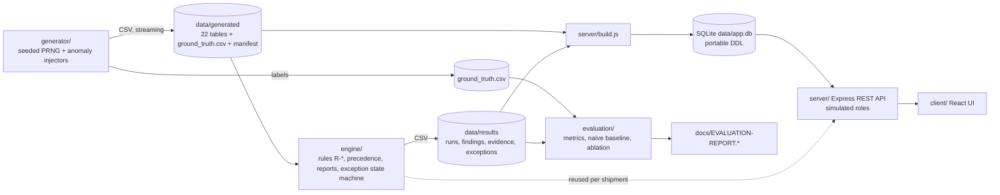

# Architecture

A modular monolith in Node.js (ESM). One repository, one process at run time, no message queue and no external service. The generator and the compliance engine are plain functions with no database dependency; the database, the API and the UI are layers on top of their output.

## Overview

The engine never reads `ground_truth.csv`. Only `evaluation/` and documentation scripts read it, and only to compare.

## Data flow

1. `npm run generate` writes the 22 table CSVs plus `ground_truth.csv` and `manifest.json` (row counts and sha256 per file). Output is deterministic for a seed (default 20261022).
2. `npm run evaluate` reads the CSVs (readings through the memory-efficient `ReadingStore`), runs every DELIVERED shipment through the engine and writes `compliance_run`, `compliance_finding`, `compliance_evidence`, `excursion_report`, `excursion_evidence` CSVs.
3. `npm run db:build` creates `data/app.db` from `database/schema.sql`, loads both CSV directories with foreign keys deferred, creates indexes, runs `foreign_key_check`, seeds an exception workflow through the same state machine the API uses, and runs `ANALYZE`.
4. `npm start` serves the REST API and, when `client/dist` exists, the built UI.
5. The API re-uses the engine for one shipment at a time (`POST /api/shipments/:id/evaluate`, `GET /api/shipments/:id/report`) by loading a one-shipment slice from the database (`server/loadSlice.js`).
6. `npm run metrics` compares engine statuses with the ground truth (`docs/EVALUATION-REPORT.*`).

## Modules

| path | responsibility |
|---|---|
| `database/schema.sql` | the only DDL; portable PostgreSQL/SQLite |
| `generator/` | seeded PRNG (`prng.js`), ID formats, master data, per-shipment baseline, 13 labelled anomaly injectors, streaming CSV writers, the validator (`validateData.js`) |
| `engine/` | pure evaluators per rule group (`evaluators/`), precedence and evidence gating (`compliance.js`), per-run idempotence fingerprint, traceable reports (`report.js`), exception state machine (`exceptions.js`), CLI |
| `evaluation/` | confusion matrix, per-label and per-rule metrics, named rates, naive baseline, ablation |
| `server/` | `build.js` (DB load), `db.js` (SQLite helpers), `routes/read.js`, `routes/write.js`, `roles.js` (permission table), `http.js` (error shape, paging, validation), `app.js` (Express app + static UI) |
| `client/` | Vite + React (JSX) UI; `lib/` has pure functions with Vitest tests |
| `scripts/` | reproducibility check, stats, exports, performance and docs generators, `verify.js` |
| `tests/` | `node --test` suites for schema, generator, engine, evaluation, property, scale, API, docs |

## Key decisions

| decision | chosen | alternatives considered | why |
|---|---|---|---|
| Deployment shape | modular monolith, one repo, one process | microservices (generator, engine, API separately) | a time-boxed prototype with one team; module boundaries are enforced by plain imports and tests (the engine never imports the DB layer) |
| Decision logic | deterministic rule engine with an explicit precedence | ML or LLM classifier | compliance decisions must be explainable, reproducible and cite evidence; every finding stores the rule code and the reading IDs it rests on. There is no AI in the decision path |
| Application DB | SQLite (`node:sqlite`) with portable DDL | PostgreSQL only | zero-install, a single file, fast enough for 1.4 M rows; the DDL avoids vendor-specific syntax so PostgreSQL remains an option (not tested) |
| Logger identity (A-01) | physical `logger` (reused, 1,000 devices) plus `logger_assignment` (one per deployment, ID `LOG-<shipment>-NN`) | one logger row per shipment | the statement asks for 1,000 loggers and an ID containing the shipment id; they cannot describe the same rows |
| Excursion isolation (R-ISO-01) | runs are computed inside each assignment window | per-logger stream | a reused logger would merge excursions of adjacent shipments; the naive baseline shows the error this causes |
| Missing data | never assumed in range; gaps and untrusted loggers give INDETERMINATE | interpolate or treat as in range | no evidence of failure is not evidence of compliance |
| History | runs, events and calibrations are appended, never overwritten; re-evaluation with the same inputs is a no-op (fingerprint) | update in place | audit trail and idempotence |
| Ground truth | produced by the injector from what it injected, stored outside the DB | derive labels with the engine | avoids circular 100% metrics |
| Roles | simulated through an `x-role` header and an explicit permission table | real authentication | out of scope for a prototype; documented as a limitation |

## How the five failure categories are told apart

| category | how it shows up | where |
|---|---|---|
| **Business non-compliance** | status NON_COMPLIANT with a FAIL finding (R-TEMP-03 confirmed excursion time over the allowance; R-ROUTE-01..04) | engine findings, `compliance_run.compliance_status` |
| **Invalid input** | rejected before anything is stored: HTTP 400 `VALIDATION_ERROR` / `INVALID_JSON` / `UNKNOWN_REFERENCE`, 409 `ASSIGNMENT_OVERLAP`; a bad reading in a batch is returned in `rejected[]` and never aborts the batch | `server/http.js`, `routes/write.js` |
| **Data-quality exception** | the data is stored but flagged: overlapping assignments (R-LOG-04), reading/assignment link disagreement (R-LOG-05), custody timestamp problems (R-CUS-02), legacy report that spills across shipments (`CROSS_SHIPMENT_REPORT`), SUSPECT/INVALID readings excluded from evidence | findings with result WARNING or INDETERMINATE; `excursion_report` rows |
| **System failure** | HTTP 500 `INTERNAL_ERROR` with no stack trace in the body; never turned into a compliance status | `server/http.js` |
| **Incomplete evidence** | status INDETERMINATE: gaps over the limit (R-GAP-01), no or untrusted logger (R-LOG-02/03), marginal readings (R-TEMP-04), wrong policy (R-POL-01), broken custody (R-CUS-01) | engine; R-TEMP-00 explains why temperature was not evaluated |

## Security notes
- Roles are **simulated**. The `x-role` header is trusted as sent; there is no authentication, no sessions and no per-user audit. Do not expose the server to an untrusted network.
- All SQL is parameterized; user-supplied `LIKE` text is escaped.
- JSON body limit 5 MB, page size capped at 200, errors never include stack traces.
- The report HTML renderer escapes all interpolated values (tested).
- The API never reads `ground_truth.*`. Configuration is through environment variables (`PORT`, `DB_PATH`); there are no secrets.
- Dependencies: Express for the API; React, React Router, Recharts, Vite and Vitest only inside `client/`.

## Scalability notes
Measured numbers are in [PERFORMANCE.md](PERFORMANCE.md). At 5,000 shipments (1.2 M readings) everything runs under the default Node heap: generation and validation stream the readings, the engine uses per-logger typed arrays with binary search, and the database loads in a single pass with deferred indexes. The shipments list scans the current runs (fine at this size). Beyond roughly ten times this volume the next steps would be partitioning readings by logger or month, a PostgreSQL deployment, and incremental evaluation triggered by new readings. The full dataset is committed gzip-compressed (`data/full`, every file under 50 MB) with a manifest; `npm run export:full` regenerates it.

## Next steps
- Real authentication and per-user audit trail; row-level permissions.
- Test the DDL and the API on PostgreSQL.
- Multi-label shipments (the generator injects one anomaly per shipment, so interactions are not exercised).
- Real sensor effects (drift, spikes, clock error) and measured, not assumed, calibration uncertainty.
- Streaming ingestion with event-driven re-evaluation and notifications for new exceptions.
- Code-split the UI bundle (currently one 606 KB chunk).
