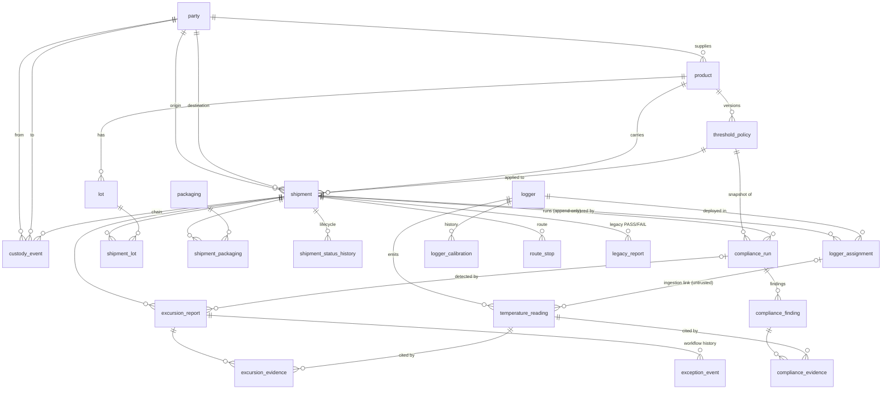

# Database schema

Source: [`database/schema.sql`](../database/schema.sql) (22 tables, portable DDL for PostgreSQL and SQLite; only SQLite is exercised by the tests and the API). Field-level detail (types, validation) is in [DATA-DICTIONARY.md](DATA-DICTIONARY.md); enumerations and rules are in [BUSINESS-RULES.md](BUSINESS-RULES.md). Ground truth is **not** in the database.

## ER diagram

## Tables

| table | primary key | foreign keys | notes |
|---|---|---|---|
| party | party_id | - | suppliers, carriers, warehouses |
| product | product_id | supplier_party_id -> party | required range and default allowed excursion |
| lot | lot_id | product_id -> product | |
| packaging | packaging_id | - | supported range, qualified duration |
| logger | logger_id | - | physical device (`LGR-`), reused across shipments |
| logger_calibration | calibration_id | logger_id -> logger | calibration history; unique (logger_id, calibrated_on) |
| threshold_policy | policy_id | product_id -> product | effective-dated versions; unique (product_id, policy_version) |
| shipment | shipment_id | product_id, policy_id, origin_party_id, destination_party_id | |
| shipment_status_history | history_id | shipment_id -> shipment | append-only lifecycle |
| shipment_lot | (shipment_id, lot_id) | shipment_id, lot_id | N:M bridge |
| shipment_packaging | (shipment_id, packaging_id, assigned_from) | shipment_id, packaging_id | N:M bridge, effective-dated |
| logger_assignment | logger_assignment_id (`LOG-<shipment>-NN`) | logger_id, shipment_id | window of one deployment; unique (shipment_id, logger_id, assigned_from) |
| temperature_reading | reading_id (`TEMP-<logger>-<timestamp>`) | logger_id, logger_assignment_id (optional) | unique (logger_id, recorded_at) |
| custody_event | custody_event_id | shipment_id, from_party_id, to_party_id | unique (shipment_id, event_sequence) |
| route_stop | route_stop_id | shipment_id | planned and actual times |
| compliance_run | compliance_run_id | shipment_id, policy_id | append-only; unique (shipment_id, input_fingerprint); `is_current` marks the latest |
| compliance_finding | finding_id | compliance_run_id | one per rule per run |
| compliance_evidence | (finding_id, reading_id) | finding_id, reading_id | which readings a finding rests on |
| excursion_report | excursion_id | shipment_id, logger_id, logger_assignment_id, policy_id, compliance_run_id (all except shipment_id optional) | engine exceptions and legacy imports (`source`) |
| excursion_evidence | (excursion_id, reading_id) | excursion_id, reading_id | |
| exception_event | exception_event_id | excursion_id | append-only investigation history |
| legacy_report | legacy_report_id | shipment_id | legacy PASS/FAIL, makes "silently passed" observable |

## Cardinality

| relationship | cardinality | implemented by |
|---|---|---|
| product - threshold_policy | 1:N | threshold_policy.product_id |
| product - lot | 1:N | lot.product_id |
| shipment - lot | **N:M** | bridge table `shipment_lot` |
| shipment - packaging | **N:M** (effective-dated) | bridge table `shipment_packaging` |
| shipment - logger | **N:M** | `logger_assignment` is both the bridge and the carrier of the time window |
| logger - temperature_reading | 1:N | temperature_reading.logger_id |
| logger_assignment - temperature_reading | 1:N, optional | temperature_reading.logger_assignment_id (nullable, not trusted; the engine re-derives the link from the window) |
| shipment - custody_event / route_stop / legacy_report | 1:N | shipment_id |
| shipment - compliance_run | 1:N | compliance_run.shipment_id; at most one `is_current` per shipment by convention (the API flips the flag in one transaction) |
| compliance_run - compliance_finding | 1:N | compliance_finding.compliance_run_id |
| compliance_finding - reading | N:M | bridge `compliance_evidence` |
| excursion_report - reading | N:M | bridge `excursion_evidence` |
| excursion_report - exception_event | 1:N | exception_event.excursion_id |
| shipment - threshold_policy | N:1 | shipment.policy_id (the policy *applied*; the run stores the policy *used*) |

There is no 1:1 relationship in the schema. The closest is "a shipment has at most one current compliance_run".

## Optional relationships (nullable foreign keys)
- `temperature_reading.logger_assignment_id`: the ingestion-time link, may be missing or wrong.
- `excursion_report.logger_id`, `logger_assignment_id`, `policy_id`, `compliance_run_id`: legacy imports have no run; some data-quality exceptions have no logger.
- `threshold_policy.effective_to`: NULL means open-ended.
- `logger_assignment.assigned_to`, `shipment.departure_time` / `arrival_time`: unknown until the shipment moves.

## Effective-dated tables
- `threshold_policy` (`effective_from`, `effective_to`): exactly one policy per product is effective at an instant; a new open-ended policy closes the previous one. The policy effective at departure is the one a shipment should use (rule R-POL-01).
- `logger_calibration` (`calibrated_on`, `expires_on`): calibration validity is judged at every reading time, not from the current logger row.
- `logger_assignment` (`assigned_from`, `assigned_to`): readings belong to a shipment only inside its assignment window (R-ISO-01).
- `shipment_packaging` (`assigned_from`, `assigned_to`).

## Lifecycle states
- **Shipment:** PLANNED -> PACKED -> IN_TRANSIT -> DELIVERED, or CANCELLED from PLANNED/PACKED. Only DELIVERED shipments are evaluated.
- **Compliance status (not a lifecycle):** COMPLIANT, NON_COMPLIANT, INDETERMINATE.
- **Exception:** OPEN -> ASSIGNED -> INVESTIGATING -> RESOLVED, with INVESTIGATING -> ESCALATED and ESCALATED -> INVESTIGATING or RESOLVED. RESOLVED is terminal (`engine/exceptions.js`).
- **Policy:** DRAFT, ACTIVE, SUPERSEDED, RETIRED.
- Also: lot (CREATED, RELEASED, QUARANTINED, EXPIRED), logger device (AVAILABLE, IN_USE, MAINTENANCE, RETIRED), assignment (ASSIGNED, COMPLETED, CANCELLED).

## History and append-only tables
`shipment_status_history`, `compliance_run` (+ findings and evidence), `exception_event`, `logger_calibration` and `threshold_policy` versions are never overwritten. A re-evaluation with changed inputs creates a new `compliance_run` and clears `is_current` on the old one; the old run, its findings and its evidence stay. Same inputs give the same `input_fingerprint`, so no duplicate run is written.

## Indexes
| index | on | serves |
|---|---|---|
| idx_reading_logger_time | temperature_reading(logger_id, recorded_at) | the window query that every evaluation and chart uses |
| idx_assignment_logger_from | logger_assignment(logger_id, assigned_from) | overlap checks |
| idx_assignment_shipment | logger_assignment(shipment_id) | |
| idx_custody_shipment, idx_route_stop_shipment | by shipment_id | |
| idx_excursion_shipment, idx_excursion_source | shipment_id; (source, status) | shipment detail, exception lists |
| idx_run_shipment, idx_run_current | shipment_id; (shipment_id, is_current) | current-run joins |
| idx_shipment_status, idx_shipment_product | shipment_status; product_id | list filters |
| idx_finding_run | compliance_finding(compliance_run_id) | findings of a run |
| idx_event_excursion | exception_event(excursion_id) | exception history |

Unique constraints (see the table above) provide the remaining indexes, including `UNIQUE (logger_id, recorded_at)` that makes reading ingestion idempotent.

## Not enforced by the DDL (validator and engine instead)
Overlapping logger assignments, reading-versus-assignment consistency and cross-row date coverage are data-quality checks, because the system must be able to *store* bad input and flag it rather than reject it.
